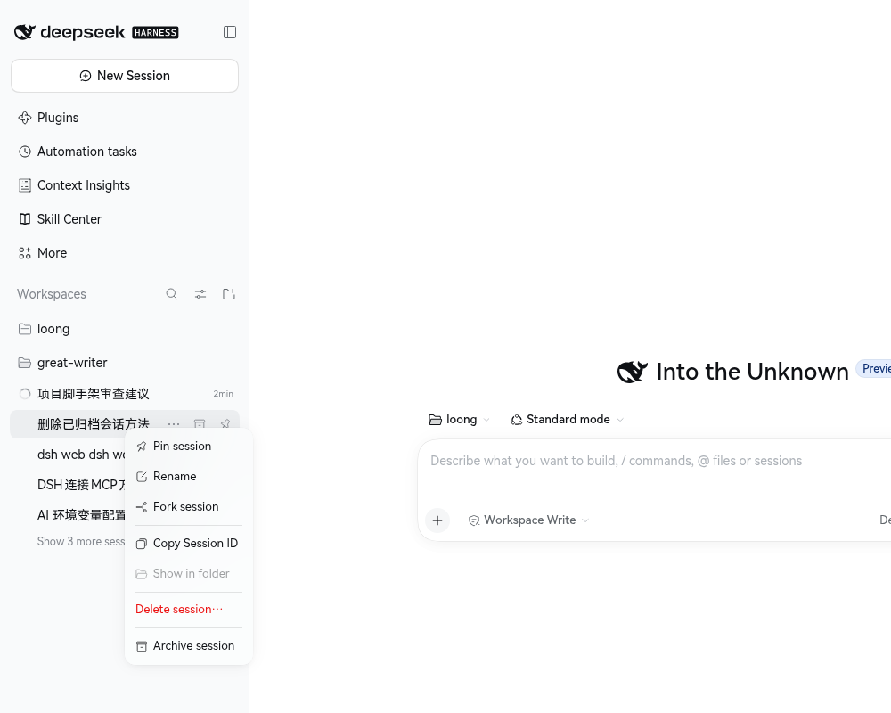

# 会话删除（session-delete）

> 一个 DSH Web 插件：在会话右键菜单中永久删除**冷会话**（含已归档会话），带二次确认与明确的不可撤销风险提示。



## 特性

- **慎重删除**：两步确认（风险说明 → 最后确认），所有文案均为中文，并与 DSH 界面语言联动（内置 en / zh 词典）。
- **只删冷会话**：会话仍在当前 DSH 进程中活跃时拒绝删除，并提示先归档、重启 DSH Web。
- **删除彻底**：同时清理会话日志文件、会话目录、归档标记、置顶标记、工作区分组、投影缓存，以及投递到该会话的提醒 / 定时任务。
- **写锁保护**：删除期间持有持久化层的写入锁，避免其它写入者继续追加数据。
- **失败可解释**：所有失败都有稳定的错误码与中文提示，部分清理失败以告警形式返回，不影响主流程。
- **TypeScript 工程**：源码、类型、构建脚本、测试与文档均为 TypeScript / Markdown，注释全部中文。

## 安装

本插件以本地 bundle 形式安装到 DSH 的 profile：

```bash
# 1. 准备构建产物（插件加载的是 lib/ 下的编译结果）
npm install
npm run build
```

```text
# 2. 通过 DSH 插件管理器（GUI 的“插件”页，或 plugin_manager 工具）安装本地目录
plugin_manager action="install_bundle" target="/home/loong/projects/my/session-delete"
```

卸载：

```text
plugin_manager action="remove_bundle" target="@local/session-delete"
```

> **注意**：修改宿主侧代码（`src/host/**`、`src/index.ts`）后需要重新安装 / 重载 bundle，运行中的 DSH Web 才会加载新的宿主入口；仅修改客户端代码时，重新构建后刷新页面即可（客户端 bundle 由宿主按内容哈希提供）。

## 使用

1. 在左侧会话列表中，对目标会话点击右键（或“更多”菜单）。
2. 选择 **删除会话…**（仅当会话已落盘、且当前不在进程中活跃时出现）。
3. 阅读风险说明后点击 **继续**。
4. 在最后确认中点击 **永久删除**。

删除成功后会出现“已删除会话”的提示，会话列表自动刷新。若清理过程中有非致命失败，浏览器控制台会输出 `session-delete: cleanup warnings` 及明细。

## 工作原理

插件分为两半：

| 部分 | 入口 | 职责 |
| --- | --- | --- |
| 宿主半 | `src/index.ts` → `lib/index.js` | 注册 `/session-delete/api` 前缀路由，执行状态查询与真正的删除 |
| 客户端半 | `src/client/index.tsx` → `lib/client.js` | 注册会话右键菜单项与确认对话框，调用宿主 API |

宿主删除算法（详见 [docs/architecture.md](docs/architecture.md)）：

1. 读取会话快照，确认存在且不在当前进程中活跃。
2. 以 `write` 模式打开会话，原子抢占单写锁。
3. 删除会话日志文件（先删日志，再删目录，崩溃时不会留下可被误认的残留）。
4. 删除会话目录。
5. 释放写锁。
6. 尽力清理归档 / 置顶 / 工作区分组 / 投影缓存 / 定时任务等元数据。
7. 复核持久化层，若仍报告该会话则给出刷新提示。

## HTTP 接口

宿主在 `/session-delete/api` 前缀下提供两个接口：

- `GET /session-delete/api/status?sessionId=<id>`：返回会话概览，结构为 `{ ok: true, session: SessionSummary }`。
- `POST /session-delete/api/delete`：请求体为 `{ "sessionId": "<id>" }`，成功返回 `{ ok: true, deleted, warnings }`。

失败响应统一为 `{ ok: false, code, message? , warnings? }`。

### 失败码

| HTTP | code | 含义 |
| --- | --- | --- |
| 400 | `bad-request` | 请求 URL 无法解析 |
| 400 | `bad-json` | 请求体不是合法 JSON |
| 400 | `invalid-session-id` | 会话 id 缺失或格式非法 |
| 401 | `unauthorized` | 连接层拒绝（未认证） |
| 403 | `forbidden` | 连接层拒绝（无权限） |
| 404 | `not-found` | 会话不存在或路由未知 |
| 409 | `live` | 会话仍活跃，或写锁被其它写入者占用 |
| 413 | `body-too-large` | 请求体超过 8 KB |
| 422 | `unsupported-format` | 会话日志格式不受支持，拒绝不安全删除 |
| 500 | `claim-failed` | 抢占写锁时发生未知错误 |
| 500 | `filesystem-error` | 日志文件无法删除 |
| 500 | `internal-error` | 未预期异常 |

## 安全与限制

- **不可撤销**：删除不进入回收站，消息、工具输出、分叉记录都会从磁盘移除。
- **活跃会话不可删**：必须先归档并重启 DSH Web，确保会话不在当前进程中活跃。
- **共享附件保留**：附件库中的文件不会被删除，因为它们可能被其它会话引用。
- **跨进程投影缓存**：在其它 DSH 进程中内存里的投影缓存不会立刻同步，刷新页面或重启后一致。
- **格式不支持则拒绝**：无法安全删除的旧格式会话会返回 422，而不是冒险删除。

## 开发

```bash
npm install          # 安装开发依赖（npm 11 可能提示 esbuild postinstall 未执行，属正常）
npm run build        # 清理 lib → tsc 编译宿主半 → esbuild 打包客户端半
npm run typecheck    # 类型检查（源码 + 测试）
npm test             # 构建后运行全部测试
npm run check        # typecheck + test
```

目录结构：

```text
.
├── src/
│   ├── index.ts            # 宿主插件入口（apply / inject）
│   ├── protocol.ts         # 双端共享的常量、类型与响应解析
│   ├── host/               # 宿主半：路由、删除流程、元数据清理
│   └── client/             # 客户端半：菜单、对话框、i18n、样式
├── scripts/                # 构建脚本（tsc + esbuild）
├── test/                   # Node 内置测试运行器 + jsdom 组件测试
├── docs/                   # 架构、开发文档与截图
├── lib/                    # 构建产物（不入库）
├── cordis.patch.yml        # DSH bundle 补丁
└── locale/                 # 插件元数据与界面词典
```

更多细节：

- [架构说明](docs/architecture.md)
- [开发指南](docs/development.md)
- [插件详情页文案](docs/plugin-page.zh.md)
