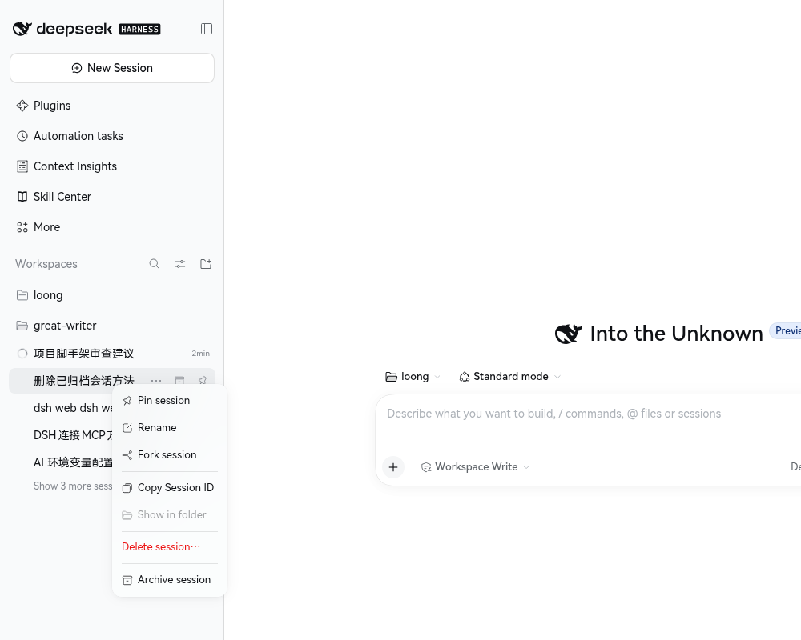

# 会话删除

在 DSH Web 的会话右键菜单中加入 **删除会话…**，用于永久删除已经落盘、且当前不在 DSH 进程中活跃的冷会话（包括已归档会话）。



## 它解决什么问题

DSH 的会话列表会长期保留历史会话。归档只能把它们从默认视图中隐藏，磁盘上的日志、附件索引、投影缓存以及投递给该会话的定时任务仍然存在。本插件提供一条**显式、两步确认、可解释失败**的删除路径，把冷会话从磁盘上彻底移除。

## 使用方式

1. 在会话列表中右键目标会话（或打开“更多”菜单）。
2. 选择 **删除会话…**。
   - 只有已落盘、且不在当前进程中活跃的会话才会出现该入口。
   - 活跃会话请先在 DSH 中归档，并重启 DSH Web。
3. 阅读风险说明，点击 **继续**。
4. 在“最后确认”中点击 **永久删除**。

删除完成后会提示“已删除会话”，列表自动刷新。若部分元数据清理失败，删除仍然成功，浏览器控制台会打印告警明细。

## 会删除什么

- 会话日志文件与会话目录；
- 该会话的全部消息、工具输出与分叉记录；
- 归档标记、置顶标记、工作区分组；
- 投影缓存；
- 投递到该会话的提醒 / 定时任务。

## 不会删除什么

- **共享附件库中的文件**：附件可能被其它会话引用，删除文件会造成连带损坏；
- **其它会话的任何数据**。

## 风险与限制

- **不可撤销**：删除不进入回收站，也不提供恢复入口。
- **活跃会话会被拒绝**：这是刻意设计，避免会话在运行中被抽走文件。
- **旧格式会话会被拒绝**：无法安全解析的日志格式返回“格式不受支持”，而不是冒险删除。
- **跨进程缓存**：其它 DSH 进程内存中的投影缓存不会立即消失，刷新页面或重启后一致。
- **删除前请确认会话不再需要**：建议先导出或归档重要内容。

## 安装

```bash
npm install
npm run build
```

然后通过 DSH 插件管理器（GUI 的“插件”页）安装本地目录 `/home/loong/projects/my/session-delete`；更新宿主侧代码后需要重新安装 / 重载插件，只改客户端代码时重新构建后刷新页面即可。

## 隐私

插件不收集、不上报任何数据。所有请求只发往当前 DSH Web 同源的 `/session-delete/api`，删除操作只作用于本机会话存储。
